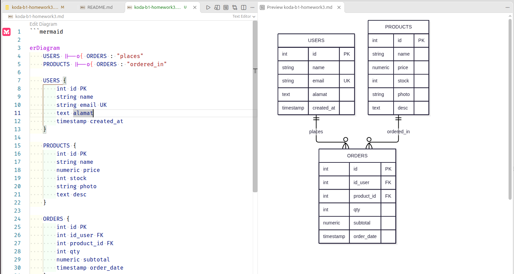
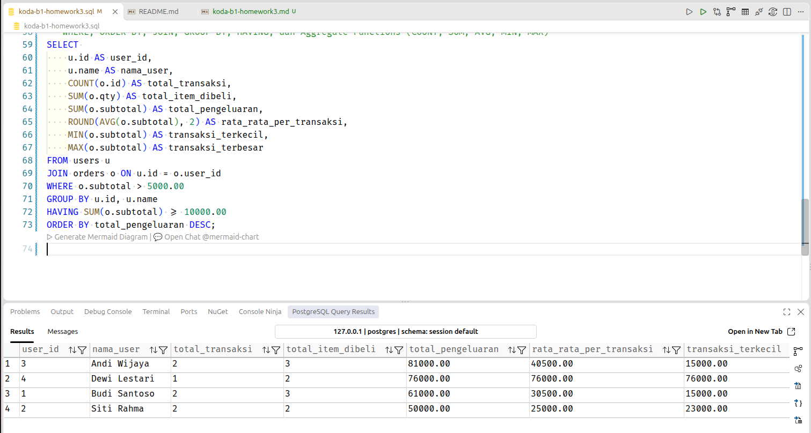

# homework 3 - database normalization dan sql query
proyek ini dibuat untuk memenuhi tugas database dengan mengimplementasikan ERD, Normalisasi 3NF, query SQL, serta query agregasi.

## 1. Penjelasan Database & Normalisasi 3NF
database ini terdiri dari 3 tabel utama yang telah memenuhi 3NF:
- `users`: Menyimpan informasi pengguna. Menggunakan constraint `UNIQUE` pada email.
- `products`: Menyimpan katalog produk, harga, dan stok. Menggunakan constraint `CHECK` untuk memastikan harga > 0.
- `orders`: Menyimpan transaksi pemesanan. Menghubungkan `users` dan `products` melalui `FOREIGN KEY`.

## 2. Diagram ERD

## 3. SQL Constraints yang Digunakan
- PRIMARY KEY: `id` pada semua tabel.
- FOREIGN KEY: `id_user` dan `product_id` pada tabel `orders`.
- NOT NULL: Diaplikasikan pada atribut wajib seperti nama, harga, dan kuantitas.
- UNIQUE: `email` pada tabel `users`.
- CHECK: Memastikan `price > 0`, `qty > 0`, dan `subtotal >= 0`.
- DEFAULT: Tanggal dibuat (`created_at`/`order_date`) otomatis terisi waktu saat ini.

## 4. Screenshot Hasil Eksekusi Query
